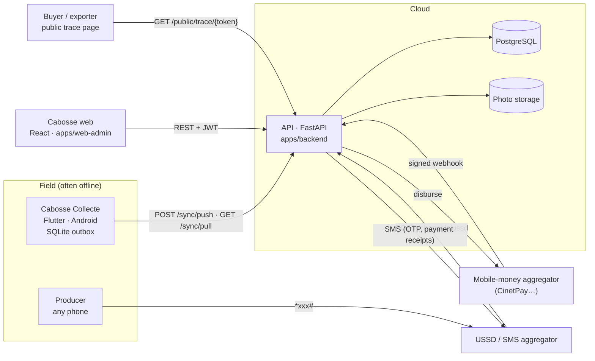

# Architecture

## System overview



| Component | Folder | Stack | Role |
|---|---|---|---|
| API | `apps/backend` | Python 3.12, FastAPI, SQLAlchemy 2 (async), Alembic, PostgreSQL (SQLite in dev/tests) | Single source of truth: prices, amounts, statuses, audit |
| Web app | `apps/web-admin` | React 18, TypeScript, Vite, TanStack Query, Leaflet | Cooperative manager dashboard + public buyer trace page (`/trace/:token`) |
| Collector app | `apps/mobile-collector` | Flutter 3.24, sqflite, mobile_scanner, geolocator | Offline-first weighing entry |
| Producer channel | `apps/backend/app/services/ussd.py` | USSD callback (aggregator convention) | Balance, last deliveries, price of the day |

## Repository layout

```
agriTechCMS/
├── apps/
│   ├── backend/            FastAPI service, migrations, tests, seed
│   ├── web-admin/          React SPA
│   └── mobile-collector/   Flutter app
├── docs/
│   ├── business/  finance/  technical/   ← source of truth
│   └── archive/            original documents, unchanged
├── docker-compose.yml      PostgreSQL + API for local runs
└── Makefile                one-word commands (make dev, make test, make seed…)
```

## Backend layering

```
app/api/*.py        HTTP: parsing, auth dependency, envelope. No business rules.
app/services/*.py   Business rules (pricing, ingest, sync, lots, payments, USSD).
app/models.py       SQLAlchemy models — every business table has cooperative_id.
app/schemas.py      Pydantic contracts (the API surface).
app/core/*          Cross-cutting: config, security, errors, ids, geo, time.
```

Rules that keep the system honest:

1. **The server computes money.** The phone shows an estimate; `amount = round_half_up(weight_kg × unit_price)` is
   computed server-side with the price in force on the *collection date*.
2. **Every write is attributable.** `audit_events` records who created/edited/validated/rejected/paid what, with diffs.
3. **Tenancy in every query.** Users carry `cooperative_id`; services filter on it; tests cover cross-tenant access.
4. **Idempotency by design.** Collections are keyed by a `client_uuid` generated on the phone; webhooks are idempotent.

## Environments

| | Dev / demo | Pilot (production) |
|---|---|---|
| DB | SQLite file, schema auto-created | Managed PostgreSQL, `alembic upgrade head` |
| SMS | `console` provider: messages stored and visible in *Paramètres → SMS* | Real gateway (to be wired in `services/sms.py`) |
| Payments | `sandbox` provider (account ending in `00` fails, to demo retries) | `cinetpay` adapter (verify API, sandbox test first) |
| OTP | code echoed in the API response (`AGT_OTP_ECHO`) | never echoed (`AGT_ENV=prod` forces it off) |
| Hosting | laptop (`make dev`) | Container (Dockerfile) behind HTTPS; region close to West Africa |

## Decisions

See [adr/](adr/) for the reasoning behind the main choices.
