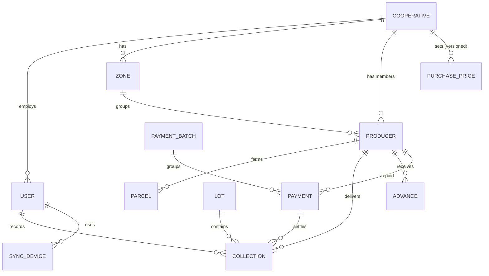
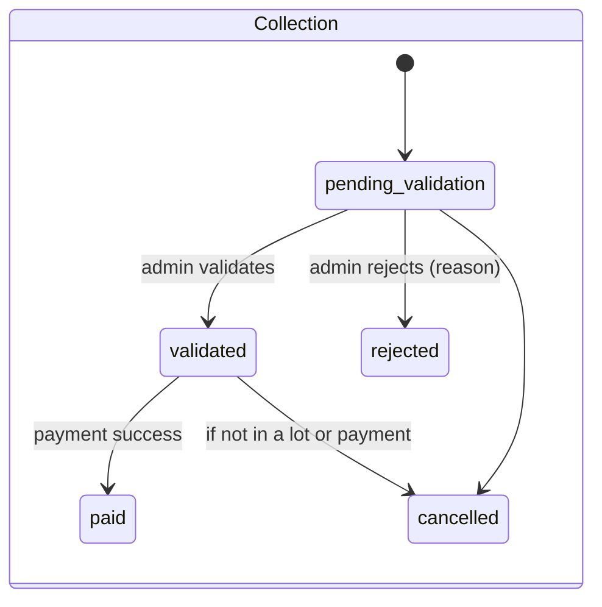
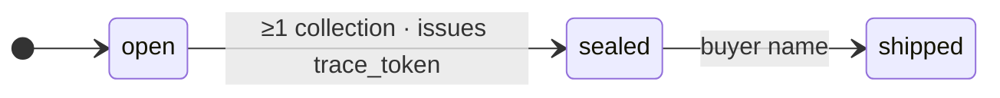
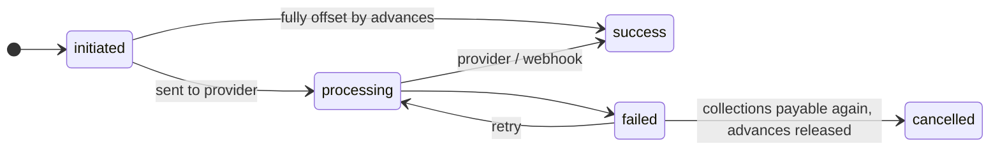

# Data model

Source: [`apps/backend/app/models.py`](../../apps/backend/app/models.py). Migrations: `apps/backend/migrations`.

## Conventions

- **IDs**: prefixed, time-sortable strings (`prod_01k6f3…`, `col_…`, `lot_…`). Safe in URLs and logs.
- **Money**: integer XOF. **Weights**: `NUMERIC(10,2)` kg. **Moisture**: `NUMERIC(4,1)` %.
- **Time**: stored UTC (`UTCDateTime`); Côte d'Ivoire is UTC+0 all year, so UTC dates are local dates.
- **Campaign**: derived, not stored — cocoa campaign `2026-2027` = 1 Oct 2026 → 30 Sep 2027 (`campaign_start_month` per cooperative).
- **Tenancy**: every business table has an indexed `cooperative_id`.
- **Soft deletes**: producers and users are deactivated, collections cancelled; nothing that carries money is deleted.

## Tables

| Table | Purpose | Notable columns |
|---|---|---|
| `cooperatives` | Tenant | `code` (prefix of producer codes), thresholds `max_moisture_percent`, `max_weight_kg`, counters `producer_seq`, `lot_seq` |
| `users` | Staff | `phone` (unique, login identity), `role` (`super_admin`/`admin`/`collector`) |
| `otp_challenges`, `refresh_tokens` | Auth | only HMACs stored |
| `zones` | Villages / sectors | unique per cooperative |
| `producers` | Members | `code` printed on QR card, mobile-money operator + account, `status` |
| `parcels` | Plots | `geometry` (GeoJSON Point/Polygon), `area_hectares` declared vs `measured_area_hectares` computed, `deforestation_status` |
| `purchase_prices` | Price grid | `product`, `quality`, `price_per_kg`, `effective_from`, `effective_to` (adding a price closes the previous open one) |
| `collections` | Weighings | `client_uuid` (unique per coop), `unit_price` frozen at entry, `amount`, `collected_at` (clock-corrected) and `collected_at_device`, `clock_offset_seconds`, GPS, `lot_id`, `payment_id` |
| `lots` | Batches sold | `reference` `LOT-2026-DAL-0007`, `status`, totals, `trace_token` (public link) |
| `advances` | Pre-harvest cash | `amount`, `remaining` |
| `payment_batches`, `payments` | Payouts | per producer: `gross_amount`, `advance_deduction`, `amount` sent, `advance_allocations`, provider refs |
| `uploads` | Photos | sha256, size, path |
| `sync_devices` | Phones | last push/pull, clock offset, app version |
| `issues` | Problem reports | `reference` `SIG-0042`, `source` (web/mobile/ussd/public), `category`, `status` (open → in_progress → resolved), links to collection / producer / lot, `context` (diagnostics, ≤ 4 KB), `client_uuid` for offline retries |
| `audit_events` | Append-only log | `entity`, `entity_id`, `action`, `changes` (`{"field": [old, new]}`), actor |
| `notifications` | Outgoing SMS | with the console provider, this is the demo SMS inbox |

## State machines

Only `pending_validation` collections can be edited (by an admin, with a mandatory reason, re-priced, audited).

## Moving to PostGIS (later)

Parcels are GeoJSON in a JSON column so the MVP runs on SQLite and any PostgreSQL. When we need spatial
queries (overlap between parcels, intersection with protected forests or deforestation alerts), add a
`geometry(Geometry, 4326)` column populated from `geometry`, with a GiST index.
